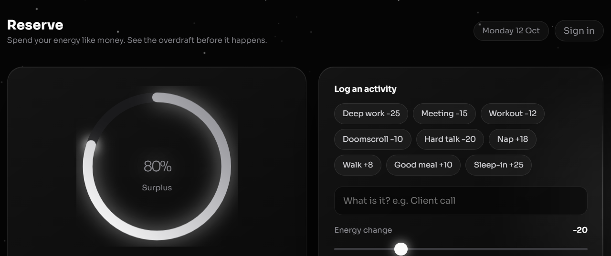
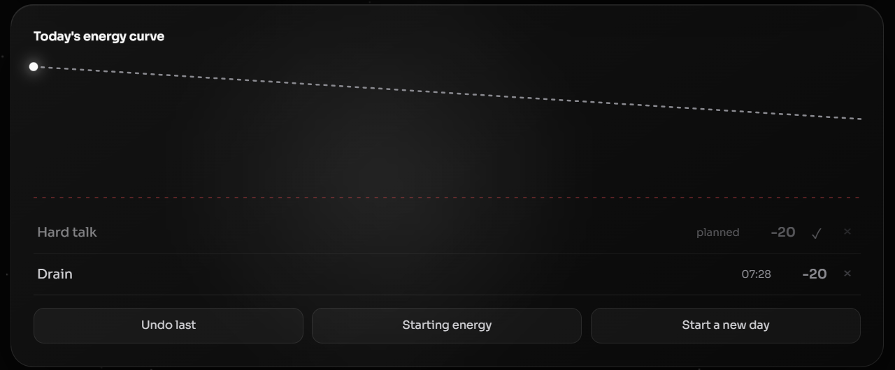
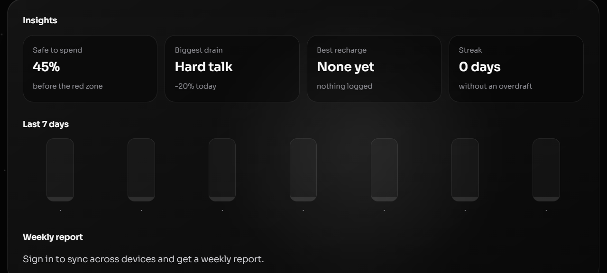

# Reserve

**Budget your energy like money. See the overdraft before it happens.**


Most people overbook their day because they track **time**, not **energy**. Reserve treats energy as a bank account. Activities are withdrawals (deep work, meetings, doomscrolling) or deposits (a nap, a walk, a good meal). It forecasts where your day will end, warns you before you overdraw, and carries an overdraft into tomorrow so there is a real cost to pushing through.



## Features

- **Live reserve ring** with an animated count, a glowing tip, and a red debt state
- **Plan mode**: planned activities only change the end-of-day forecast until you mark them done
- **Projection before you commit**: the slider shows where the day will end before you add anything
- **Overdraft carry-over**: half the debt follows you into the next day (never below 40%)
- **Insights**: safe-to-spend, biggest drain, best recharge, and a no-overdraft streak
- **Energy curve** with solid (done) and dashed (planned) segments, plus a 7-day history
- **Weekly report**: a plain-language summary and one concrete tip, generated from your closed days
- **Optional accounts and sync** so your days follow you across devices
- **Works offline** without an account; data stays in the browser
- **Premium black and grey glass UI** with smooth motion, and `prefers-reduced-motion` respected





## Usage

### Log your day

1. Tap a preset chip (for example **Deep work -25**) or type your own activity name.
2. Drag the slider to set the energy change. Negative values drain, positive values recharge.
3. Read the projection under the slider, then press **Add to today**.

The ring updates, a floating `-25` rises out of it, and the entry joins the ledger.

### Plan ahead

Tick **Plan it for later** before adding. Planned items appear faded, count toward **Forecast by night**, and are drawn as a dashed line. When you finish one, press its check mark to move it into your real energy.

### Read the ring

| Level | State | What it means |
| --- | --- | --- |
| 70% and above | Surplus | You have room. Protect it for what matters most |
| 40% to 69% | Steady | One heavy task is fine, two is pushing it |
| 15% to 39% | Running low | Stop adding drains and schedule a recharge |
| 0% to 14% | Nearly empty | One more drain puts you in debt |
| Below 0% | In debt | You have overdrawn. Tomorrow pays for it |

### End the day

Press **Start a new day**. Today is saved to your 7-day history. If you overdrew, tomorrow starts at `max(40, 100 + overdraft / 2)`. Otherwise it starts at 100%.

### Other controls

- **Undo last** removes the most recent entry
- **Starting energy** lets you begin the day below 100% (a bad night's sleep, for example)
- Press **N** to jump to the activity name field
- **Sign in** syncs your data and unlocks the weekly report

## Tech stack

| Layer | Technology |
| --- | --- |
| Frontend | Vanilla JS, SVG, canvas. A single file with no build step |
| Backend | Node.js, Express |
| Database | MongoDB with Mongoose |
| Auth | bcryptjs password hashes, JWT (7-day expiry) |
| Hardening | helmet with a CSP, rate-limited auth routes, strict input validation |
| Testing and CI | `node:test` with no extra dependencies, GitHub Actions on Node 18, 20 and 22 |

## Project structure

```
reserve/
├── client/index.html          UI, served by Express
├── server/
│   ├── src/
│   │   ├── app.js             Express app, security headers, static hosting
│   │   ├── index.js           Database connection and server start
│   │   ├── config.js          Environment variable checks
│   │   ├── lib/energy.js      Pure logic: carry-over, streak, weekly report
│   │   ├── lib/validate.js    Input validation
│   │   ├── middleware/auth.js JWT check
│   │   ├── models/            User, Day
│   │   └── routes/            auth, state, report
│   └── tests/                 Unit tests
├── docs/screenshots/
├── .github/workflows/ci.yml
└── render.yaml
```

## Getting started

Requirements: Node 18 or newer, and a MongoDB database (local, or a free MongoDB Atlas cluster).

```bash
git clone https://github.com/manashwebdev/reserve.git
cd reserve/server
cp .env.example .env      # then edit the values below
npm install
npm run dev
```

Open http://localhost:3000.

### Environment variables

| Variable | Required | Description |
| --- | --- | --- |
| `MONGODB_URI` | yes | MongoDB connection string |
| `JWT_SECRET` | yes | Random string of 16+ characters used to sign tokens |
| `PORT` | no | Port to listen on (default `3000`) |

Generate a secret with `node -e "console.log(require('crypto').randomBytes(32).toString('hex'))"`.

### Run the tests

```bash
cd server
npm test
```

## API

All routes are prefixed with `/api`. Protected routes need `Authorization: Bearer <token>`.

| Method | Route | Auth | Purpose |
| --- | --- | --- | --- |
| POST | `/auth/register` | no | Create an account and return a token |
| POST | `/auth/login` | no | Sign in and return a token |
| GET | `/state` | yes | Current day and recent history |
| PUT | `/state/current` | yes | Save today's start energy and activities |
| POST | `/state/close` | yes | Archive today and start the next day |
| GET | `/report/weekly` | yes | Weekly summary and tip |
| GET | `/health` | no | Health check |

Example:

```bash
curl -X POST http://localhost:3000/api/auth/register \
  -H "Content-Type: application/json" \
  -d '{"email":"you@example.com","password":"a-long-password"}'
```

## Deployment

1. Create a free cluster on MongoDB Atlas, add a database user, and allow network access from anywhere (`0.0.0.0/0`) for a hosted server.
2. Push this repository to GitHub.
3. On Render, create a new Web Service from the repo. `render.yaml` already points at `server/`.
4. Set `MONGODB_URI`. `JWT_SECRET` is generated automatically.

The frontend is served by the same Express app, so there is nothing else to configure and no cross-origin setup.

## Troubleshooting

- **"JWT_SECRET is missing or too short"**: set it in `server/.env` (or in your host's environment settings).
- **"Could not connect to MongoDB"**: check the connection string, and on Atlas check the network access list.
- **"Cannot reach the server" after deploying**: free Render services sleep when idle, so the first request can take up to a minute. Open `/api/health` to wake it.
- **Sign in says the token expired**: tokens last 7 days. Sign in again.

## Security notes

Passwords are hashed with bcrypt and never returned by the API. Auth routes are rate limited, request bodies are size-limited and validated, and responses carry a Content Security Policy. This is a portfolio-grade setup: before using it for sensitive data, add HTTPS-only cookies or token refresh, account recovery, and email verification.

## Roadmap

- Custom activity presets saved per account
- Export history as CSV
- Time-of-day energy patterns in the weekly report
- Installable PWA

## Contributing

Issues and pull requests are welcome. Run `npm test` in `server/` before opening a pull request.

## Author

**Manash Khati**, full stack developer

- GitHub: [manashwebdev](https://github.com/manashwebdev)
- LinkedIn: [manash-khati](https://www.linkedin.com/in/manash-khati-b7a1b6385)
- Portfolio: [manash-dev-portfolio.netlify.app](https://manash-dev-portfolio.netlify.app/)

## License

Released under the [MIT License](LICENSE).
